<!-- Every card is an animated SVG drawn by scripts/render_readme_cards.py and refreshed daily
     by .github/workflows/update-profile-cards.yml. Design matched to mahardikaramadhana.vercel.app.
     Spacing is baked into the SVGs, so keep this block free of blank lines and keep the 3-card
     rows on one line with no spaces between them. -->

 
 
 
 
<picture><source media="(prefers-color-scheme: dark)" srcset="./cards/title-coding-dark.svg" /></picture> 

<a href="https://mahardikaramadhana.vercel.app">mahardikaramadhana.vercel.app</a> &nbsp;/&nbsp; <a href="https://www.linkedin.com/in/mahardika-ramadhana-390a98321/">linkedin</a> &nbsp;/&nbsp; <a href="mailto:mdikaramadhana@gmail.com">email</a>

